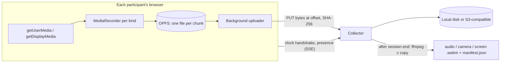

<p align="center">
  
</p>

<h1 align="center">SyncRecord</h1>

<p align="center">
  Every voice at full quality, recorded locally. One clean track per person, collected by a small server you run yourself.
</p>

SyncRecord is for podcasts and interviews held over a call (Google Meet or any call app). The call is only used for
talking. Each participant opens a SyncRecord link in their own browser and records their own microphone, camera and
optionally their screen **on their own computer**, so the quality never depends on the connection. The files are
uploaded in the background to a collector you host. After the session the collector remuxes every track and writes a
manifest with the start time of each track on one shared clock, ready for post-production.

There are no accounts, no payments and no cloud service: an invite link carries a signed token and storage is a local
directory or any S3-compatible bucket you choose.

## Features

- Chromium only (Chrome, Edge, Brave) on Mac and Windows, up to 4 participants per session.
- Separate tracks per participant and kind: microphone audio, camera video, optional screen share. Recorded with
  `MediaRecorder` in 1 s slices as WebM (VP9 video, Opus audio), each kind in its own recorder so one failure never
  takes down the others.
- Chunks are written to the browser's private storage (OPFS) first and uploaded in the background with resume.
- Crash recovery: reopen the session link after a crash and SyncRecord finds the unfinished recordings, finishes their
  upload and keeps the local copy until you delete it. Nothing expires on its own.
- Shared clock: a handshake against the collector measures each browser's clock offset; the start time of every track
  and a short sync beep (plus a "clap now" prompt) are stored in the manifest.
- Disk space check before and during recording (`navigator.storage.estimate`), with no hard session limit.
- Setup screen with device check, headphone confirmation (with a one-click skip), a speaker-bleed test, explicit
  recording consent and a live roster that shows who is recording what.
- English and Polish interface.
- Collector: small Node/TypeScript server, configured by environment variables only, runs with plain Node or Docker.

## Requirements

- Node.js 22 or newer.
- **ffmpeg** (with `ffprobe`) on the collector machine. This is a required dependency: after a session every track is
  remuxed with `ffmpeg -c copy`. The Docker image includes it.
- A Chromium-based browser for every participant. Camera and microphone access needs HTTPS, except on `localhost`.

## Quick start

```sh
npm ci
npm run build
cp .env.example .env        # set TOKEN_SIGNING_SECRET to at least 16 random characters
set -a; . ./.env; set +a    # or export the variables any other way
npm start
```

Open `http://localhost:8080`, enter your name and create a session, then send the invite link to the other
participants. For anything beyond your own machine put the collector behind an HTTPS reverse proxy.

### Docker

```sh
cp .env.example .env        # set TOKEN_SIGNING_SECRET
docker build -t sync-record .
docker run --env-file .env -e HOST=0.0.0.0 -p 8080:8080 -v syncrecord-data:/data sync-record
```

`docker-compose.example.yml` shows the same as a compose file.

## Configuration

Everything is read from the environment (see `.env.example`). Nothing is hardcoded.

| Variable | Default | Meaning |
| --- | --- | --- |
| `TOKEN_SIGNING_SECRET` | required | At least 16 characters. Signs invite and participant tokens. |
| `SESSION_CREATE_KEY` | empty | When set, creating a session requires this key. Use it on any public deployment. |
| `HOST`, `PORT` | `127.0.0.1`, `8080` | Listen address. |
| `TOKEN_TTL_HOURS` | `72` | Lifetime of invite and participant tokens. A participant token is renewed every time the participant opens the session page. |
| `MAX_UPLOAD_BYTES` | `16777216` | Largest accepted upload request. |
| `STORAGE_DRIVER` | `local` | `local` or `s3`. |
| `STORAGE_LOCAL_DIR` | `./data` | Directory for the local driver. |
| `S3_ENDPOINT`, `S3_REGION`, `S3_BUCKET`, `S3_ACCESS_KEY_ID`, `S3_SECRET_ACCESS_KEY`, `S3_FORCE_PATH_STYLE` | empty | S3-compatible storage; the bucket and both keys are required when `STORAGE_DRIVER=s3`. |
| `FFMPEG_PATH`, `FFPROBE_PATH` | `ffmpeg`, `ffprobe` | Where to find the tools. |
| `WEB_DIR` | `./dist/web` | Built web client. |

## Output

For a session with id `<id>` the storage holds:

```
session/<id>/manifest.json
session/<id>/<participant>/audio.webm
session/<id>/<participant>/camera.webm
session/<id>/<participant>/screen.webm
```

`<participant>` is `p1-<name>`, `p2-<name>` and so on (the host is `p1`). When someone records more than once (for
example after a crash) the later recordings are `audio-2.webm`, `camera-2.webm` and so on, and the manifest lists every
segment with its own start time. Raw uploaded parts stay under `session/<id>/raw/` so a failed remux can be retried
(`POST /api/sessions/<id>/end` is repeatable).

`manifest.json` lists the participants (name, consent version and time, browser) and for each track: the file, the
codec settings, the start time on the client clock and on the server clock, the clock offset with its uncertainty and
all samples taken during the recording, the sync markers, why the track ended (`stopped`, `trackEnded`, `sessionEnded`,
`crash`, `forced`) and the duration measured after remux. Server time is `clientTimeMs + offsetMs`; the client clock is
`performance.timeOrigin + performance.now()`.

Drift between microphones and variable frame rate are **not** corrected here. The manifest carries what a
post-production step needs to do that.

## How it works



**Chunks are not standalone.** `MediaRecorder` slices of one recording only make sense in order and only the first one
carries the WebM header; losing it loses the track. So each recording is treated as one append-only byte stream:

- Locally, every chunk is a separate OPFS file that is written whole and closed before the next one, so a killed tab
  loses at most the chunk in flight. Only the unbroken prefix `0..n` of chunk files counts.
- The collector accepts bytes only at the current end of a track (`PUT .../data?offset=N` with a SHA-256 header). A gap is
  answered with `409` and the offset to resume from, a repeated or overlapping request is trimmed to the new bytes, and a
  corrupted body is refused. The uploader therefore always asks the collector how many bytes it holds and continues from
  exactly there, which is also how recovery after a crash works. The collector rebuilds the byte count from the stored
  parts after a restart.
- After the session ends the parts of each track are joined in order and remuxed with
  `ffmpeg -c copy -cues_to_front 1`. Chunked `MediaRecorder` output has no duration and no seek index; this adds both
  without re-encoding.

**Clock.** Before recording, and every 60 s while recording, the client exchanges NTP-style samples with the collector.
The sample with the smallest round trip gives the offset. A track's start time is the moment of the recorder `start`
event, converted with the offset. A short beep plays when recording starts, and the host can trigger a beep for everyone
at a scheduled server time. With headphones the beep does not reach the microphone, so the UI also asks for one clap.

**Consent and visibility.** Nothing is recorded until a participant ticks the consent box and clicks "Start
recording". The consent text says what is recorded and where it goes. Every participant sees the roster with who is
recording which tracks. The collector stores the consent version and time per participant in the manifest.

**Headphones.** Browsers have no headphone API. The setup screen pre-fills the "I am wearing headphones" checkbox from
device names (AirPods, Headphones, Headset and similar, re-checked when devices change) and says plainly that this is a
guess. A separate test plays a quiet tone and listens on the microphone to detect speaker bleed. Neither blocks you:
you can confirm, or skip with one click.

## Development

```sh
npm run dev:server   # collector with reload (needs the env vars above)
npm run dev:web      # Vite dev server, proxies /api to http://127.0.0.1:8080
npm run check        # typecheck, lint, unit tests
```

### Acceptance test

`npm run test:e2e` builds nothing by itself: run `npm run build` first. It starts the built collector on port 18750
(`E2E_PORT` to change it) with a throw-away data directory, opens two isolated browser contexts with fake camera and
microphone, records a short session, cuts the guest's network for a few seconds (uploads retry, then resume), crashes
the host's renderer mid-recording, reopens the session to resume the upload, ends the session while the guest is still
recording and checks that the output files are seekable, decodable and described by a valid manifest.

It launches Chromium itself, so install one first (`npx playwright install chromium`) or pick an installed browser with
`E2E_BROWSER_CHANNEL=chrome`. To attach to a Chromium you started yourself, set `E2E_CDP_URL`; it must have been
started with the flags in `FAKE_MEDIA_ARGS` (see `tests/e2e/session.spec.ts`). The test runs with one worker because
both participants share the machine. The guest also shares a screen (the browser must auto-select a capture
source, which `FAKE_MEDIA_ARGS` does); set `E2E_SCREEN=0` to leave the screen track out.

## Limits and honest notes

- Chromium only. Safari and Firefox are not supported.
- There is no rate limiting and no session expiry on the collector. Put it behind a reverse proxy and use
  `SESSION_CREATE_KEY` if it is reachable from the internet.
- Tokens are passed in the `Authorization` header, except the live event stream, which uses a query parameter because
  `EventSource` cannot set headers. Do not log request URLs on the collector's proxy.
- Local copies live in the browser's origin storage. Clearing site data deletes them, so keep them until the collector
  shows each track as ready.
- The S3-compatible driver stores every uploaded part as its own object and streams the remuxed files with multipart
  upload. It needs a real endpoint to be tried; the automated tests use the local driver.
- Only one browser tab per session and device can record; a second tab is asked to wait until the first one is closed.
- A participant who joins twice (for example after clearing site data) uses up a second place; there is no way to remove
  a participant in v1.
- Remuxing browser output with `-c copy` can log `non monotonically increasing dts` warnings for variable frame rate
  screen captures. The files stay valid and seekable; drift and frame-rate fixes belong to post-production.
- A single collector process owns a session; running several replicas against one bucket is not supported.

## Licence

MIT, see [LICENSE](LICENSE).
