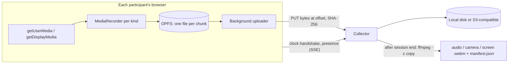

<p align="center">
  
</p>

<h1 align="center">SyncRecord</h1>

<p align="center">
  Every voice at full quality, recorded locally. One clean track per person, collected by a small server you run yourself.
</p>

SyncRecord is for podcasts and interviews held over a call (Google Meet or any call app). The call is only used for
talking. Each participant opens a SyncRecord link in their own browser and records their own microphone, camera and
optionally their screen **on their own computer**, so the quality never depends on the connection. The files are
uploaded in the background to a collector you host. After the session the collector remuxes every track and writes a
manifest with the start time of each track on one shared clock. The host then opens the session's project page to
transcribe, cut, lay out, caption and export the recording (see [Post-production](#post-production)).

There are no accounts, no payments and no cloud service: an invite link carries a signed token and storage is a local
directory or any S3-compatible bucket you choose.

## Features

- Chromium only (Chrome, Edge, Brave) on Mac and Windows, up to 4 participants per session.
- Separate tracks per participant and kind: microphone audio, camera video, optional screen share (started with the take or
  with "Share screen" at any moment of it, and stopped and started again as often as needed). Recorded with
  `MediaRecorder` in 1 s slices as WebM (VP9 video, Opus audio), each kind in its own recorder so one failure never
  takes down the others.
- Chunks are written to the browser's private storage (OPFS) first and uploaded in the background with resume.
- Crash recovery: reopen the session link after a crash and SyncRecord finds the unfinished recordings, finishes their
  upload and keeps the local copy until you delete it. Nothing expires on its own.
- Shared clock: a handshake against the collector measures each browser's clock offset; the start time of every track
  and a short sync beep (plus a "clap now" prompt) are stored in the manifest.
- Disk space check before and during recording (`navigator.storage.estimate`), with no hard session limit.
- Setup screen with device check, headphone confirmation (with a one-click skip), a speaker-bleed test, explicit
  recording consent and a live roster that shows who is recording what.
- English and Polish interface.
- Post-production on the collector, all local: transcript (faster-whisper, model chosen by available memory), cutting
  by transcript, silence removal, active-speaker and screen-share layouts (16:9, 9:16, 1:1), captions, loudness-normalised
  YouTube and audio exports, 20-90 s vertical clips and publish drafts (chapters, titles, thumbnails). Nothing is
  published anywhere by SyncRecord.
- Optional conversation in the page on LiveKit (join, mute, camera, leave, a grid of participants), **off by default**
  (`LIVEKIT_URL` and keys, see [Conversation](#conversation-optional)). Recording stays local and independent of it.
- Optional extras, both **off until configured**: a language-model provider (`LLM_URL`, or `LLM_PROVIDER=anthropic` with a key; the
  clips cut by the model, chapter titles, title drafts and a model-driven scene plan, see
  [Optional language model](#optional-language-model); the transcript text leaves the machine when it is on) and server-side
  telemetry to your own PostHog (`POSTHOG_KEY` and `POSTHOG_HOST`, see [Telemetry](#telemetry)).
- Host access across browsers: the host's project page can be opened elsewhere with a one-time claim link (see
  [Limits and honest notes](#limits-and-honest-notes)).
- Collector: small Node/TypeScript server, configured by environment variables only, runs with plain Node or Docker.

## Requirements

- Node.js 22 or newer.
- **ffmpeg** (with `ffprobe`) on the collector machine. This is a required dependency: after a session every track is
  remuxed with `ffmpeg -c copy`. The Docker image includes it.
- A Chromium-based browser for every participant. Camera and microphone access needs HTTPS, except on `localhost`.

## Quick start

```sh
npm ci
npm run build
cp .env.example .env        # set TOKEN_SIGNING_SECRET to at least 16 random characters
set -a; . ./.env; set +a    # or export the variables any other way
npm start
```

Open `http://localhost:8080`, enter your name and create a session, then send the invite link to the other
participants. For anything beyond your own machine put the collector behind an HTTPS reverse proxy.

### Docker

```sh
cp .env.example .env        # set TOKEN_SIGNING_SECRET
docker build -t sync-record .
docker run --env-file .env -e HOST=0.0.0.0 -p 8080:8080 -v syncrecord-data:/data sync-record
```

`docker-compose.example.yml` shows the same as a compose file: copy it to `docker-compose.yml`, create `.env` as above and
run `docker compose up --build`. The image listens on 8080, runs as the unprivileged `node` user and keeps recordings in
the `/data` volume (a bind mount must be writable by uid 1000). The Dockerfile builds with the classic builder as well as
BuildKit. The compose example sets no resource limits; add `mem_limit` (and `memswap_limit`) to the service if the host is shared.

The image also carries the speech engine for **Transcribe**: `python3` and `faster-whisper` (CPU wheels only, in a
virtualenv on `PATH`). The model is **not** in the image (about 1.6 GB): it downloads into `MODELS_DIR` (`/models`, a
volume, so it survives container and image upgrades) on the first transcript job, which needs outbound access to
huggingface.co once and takes a few minutes. Mount the `/models` volume (the compose example does) so it is downloaded
only once. `ASR_MODEL` and `ASR_COMPUTE_TYPE` change the model and the compute type (see [Transcript and highlights](#transcript-and-highlights) for the automatic choice). To check an image:

```sh
npm run smoke:image -- sync-record   # transcribes a short Polish fixture inside the image; first run downloads the model
```

## Configuration

Everything is read from the environment (see `.env.example`). Nothing is hardcoded.

| Variable | Default | Meaning |
| --- | --- | --- |
| `TOKEN_SIGNING_SECRET` | required | At least 16 characters. Signs invite and participant tokens. |
| `SESSION_CREATE_KEY` | empty | When set, creating a session requires this key. Use it on any public deployment. |
| `HOST`, `PORT` | `127.0.0.1`, `8080` | Listen address. |
| `TOKEN_TTL_HOURS` | `72` | Lifetime of invite and participant tokens. A participant token is renewed every time the participant opens the session page; the host's invite link is renewed the same way, so it stays valid while the host keeps coming back. |
| `MAX_UPLOAD_BYTES` | `16777216` | Largest accepted upload request. |
| `STORAGE_DRIVER` | `local` | `local` or `s3`. |
| `STORAGE_LOCAL_DIR` | `./data` | Directory for the local driver. |
| `S3_ENDPOINT`, `S3_REGION`, `S3_BUCKET`, `S3_ACCESS_KEY_ID`, `S3_SECRET_ACCESS_KEY`, `S3_FORCE_PATH_STYLE` | empty | S3-compatible storage; the bucket and both keys are required when `STORAGE_DRIVER=s3`. |
| `FFMPEG_PATH`, `FFPROBE_PATH` | `ffmpeg`, `ffprobe` | Where to find the tools. |
| `POST_DIR` | `<STORAGE_LOCAL_DIR>/post` (`./post` with S3) | Local directory for post-production: projects, proxies, analysis files and exports (always local, also with the S3 driver). |
| `POST_CONCURRENCY` | `1` | Post-production jobs that run at the same time. |
| `POST_NICE` | `10` | Niceness of ffmpeg and speech-recognition child processes. |
| `POST_THREADS` | `0` | Threads per child process; `0` lets the tool choose. |
| `POST_MIN_FREE_GB` | `10` | A job is refused (HTTP 507) when the data directory has less free space than this. |
| `POST_RETENTION` | `keep-exports` | `keep-exports` deletes proxies and intermediates after an export; `keep-all` keeps them. They can always be deleted per session. |
| `LOUDNESS_LUFS`, `TRUE_PEAK_DBTP` | `-16`, `-1` | Default loudness target and true-peak ceiling of exports. |
| `MODELS_DIR` | `<POST_DIR>/models` (`/models` in the Docker image) | Where speech models are downloaded on first use. Models never go into git. |
| `ASR_PYTHON` | `python3` | A Python with `faster-whisper` installed (`pip install faster-whisper`; the Docker image has it); the transcript job runs it as a child process. |
| `ASR_MODEL` | unset (chosen by memory) | faster-whisper model. Unset: `deepdml/faster-whisper-large-v3-turbo-ct2` with 3 GiB or more, `small` from 2 GiB, `base` from 600 MiB, with a fall back to the next smaller one when the system kills the process for memory. Set it to pin a model; `small` is a faster, less accurate choice (about 2.5x as fast; 17% instead of 7% word error rate on Polish). |
| `ASR_COMPUTE_TYPE` | `int8` | CTranslate2 compute type of the model on the CPU: `int8`, `int8_float32`, `int16`, `float32`, `auto`, ... (an unsupported one fails the transcript job). |
| `LLM_URL` | empty | Optional endpoint (base URL of an OpenAI-compatible server, or of an Anthropic API gateway) for the language-model features: clip cutting, chapter titles, title and description drafts, scene-plan suggestions. Empty = off (except `LLM_PROVIDER=anthropic` with a key, which uses `https://api.anthropic.com`), and every feature works without it. See [Optional language model](#optional-language-model). |
| `LLM_PROVIDER` | `openai-compatible` | `openai-compatible` (llama.cpp, Ollama, LiteLLM, OpenRouter, OpenAI, any server with `/v1/chat/completions`; key optional), `omp-gateway` (an OMP auth gateway; key and model required) or `anthropic` (the Anthropic Messages API; on only with a key). |
| `LLM_MODEL` | `default`; `claude-opus-5-5` for `anthropic` | Model name sent to the endpoint. Required for `omp-gateway` (`provider/model-id`). The Opus id is from Anthropic's release notes and not yet confirmed by a request; set this if it is wrong. |
| `LLM_API_KEY`, `LLM_API_KEY_FILE` | empty | Key for the endpoint (`Authorization: Bearer`; `x-api-key` for `anthropic`), from the environment or from a file (use the file with Docker/Kubernetes secrets); set at most one. Refused over plain `http://` unless the host is this machine, Docker's `host.docker.internal` or a Tailscale address. Never logged, never sent to the browser, never written to a job file. |
| `ANTHROPIC_API_KEY` | empty | The key of `LLM_PROVIDER=anthropic` when `LLM_API_KEY` and `LLM_API_KEY_FILE` are not set. Ignored by every other provider. Without a key the model stays off and no request is ever made. |
| `LIVEKIT_URL`, `LIVEKIT_API_KEY`, `LIVEKIT_API_SECRET` | empty | Optional in-page conversation on a LiveKit server you run (or LiveKit Cloud). All three or none; off when none is set. `LIVEKIT_URL` is the public `wss://` signalling URL without a path (`ws://` only for localhost); the secret must be at least 32 characters. See [Conversation](#conversation-optional). |
| `LIVEKIT_TOKEN_TTL_SECONDS` | `600` | Lifetime of a call token, 60 to 3600. A token is needed only to connect; the LiveKit server refreshes it for a connected client. |
| `POSTHOG_KEY`, `POSTHOG_HOST` | empty | Optional telemetry to a PostHog instance you operate. Off unless both are set; see [Telemetry](#telemetry). |
| `LLM_TIMEOUT_MS` | `60000` | Per-request timeout, 1000 to 600000. A timeout counts as a failure: the built-in rules answer instead. |
| `SHORTS_TIMEOUT_MS` | `120000` | Timeout of the one request that cuts clips (the shorts agent), 1000 to 600000: its prompt holds a whole transcript and Opus may think first. A timeout falls back on the rule-based clips. |
| `WEB_DIR` | `./dist/web` | Built web client. |

## Output

For a session with id `<id>` the storage holds:

```
session/<id>/manifest.json
session/<id>/<participant>/audio.webm
session/<id>/<participant>/camera.webm
session/<id>/<participant>/screen.webm
```

`<participant>` is `p1-<name>`, `p2-<name>` and so on (the host is `p1`). When someone records more than once (for
example after a crash) the later recordings are `audio-2.webm`, `camera-2.webm` and so on, and the manifest lists every
segment with its own start time. Raw uploaded parts stay under `session/<id>/raw/` so a failed remux can be retried
(`POST /api/sessions/<id>/end` is repeatable).

`manifest.json` lists the participants (name, consent version and time, browser) and for each track: the file, the
codec settings, the start time on the client clock and on the server clock, the clock offset with its uncertainty and
all samples taken during the recording, the sync markers, why the track ended (`stopped`, `trackEnded`, `sessionEnded`,
`crash`, `forced`) and the duration measured after remux. Server time is `clientTimeMs + offsetMs`; the client clock is
`performance.timeOrigin + performance.now()`.

Drift between microphones and variable frame rate are **not** corrected in the collector. The manifest carries what
the post-production step needs to do that.

## Post-production

The host opens `/project/<session id>` from the results card. Opening it creates a project under `POST_DIR` and starts
a **conform** job: every track is brought onto one timeline. Audio becomes 48 kHz mono FLAC with the start offset and the
clock drift (measured from the handshake samples against the media duration; applied only for recordings of at least
five minutes) removed, video becomes a 480p constant-frame-rate H.264 proxy, and waveform peaks and a level track are
written next to them. The original recordings are never modified.

Jobs run in a small persistent queue (`POST_DIR/<id>/jobs/*.json`). A job survives a collector restart: it is resumed
(up to three attempts) or marked failed with a reason, and a leftover ffmpeg from the killed process is removed. Jobs
refuse to start below `POST_MIN_FREE_GB` of free disk. Proxies and intermediates can be deleted per session from the
project page.

### Transcript and highlights

**Transcribe** runs a local speech-to-text job (no cloud). Each track is searched for speech first (energy on the level
track, and a track counts as speaking only when it is not just another speaker's voice leaking into its microphone), so
silent stretches and bleed never reach the engine and a silent track produces no text. The engine is
[faster-whisper](https://github.com/SYSTRAN/faster-whisper) in int8 on the CPU; it needs a Python
with `faster-whisper` installed (`ASR_PYTHON`; the Docker image has it) and downloads the model into `MODELS_DIR` on first use, never into the
repository. Without `ASR_MODEL` the server picks the largest model that fits its memory (the lower of the container's
cgroup limit and the machine's memory): `large-v3-turbo` from 3 GiB, `small` from 2 GiB, `base` from 600 MiB. If the system
still kills the speech process for lack of memory, the server drops to the next smaller model and remembers that until it
restarts; when even `base` does not fit, the job fails with a "Not enough memory" message that names the limit. A model
pinned with `ASR_MODEL` is never replaced. `base` is fast and small but noticeably less accurate, especially in Polish. Words carry their own start and end on the project timeline; words heard on two tracks at once are reduced to
the louder one. The language is detected per project or set by hand. The transcript is searchable, click-to-seek, and
exports as SRT, VTT or plain text (with or without speaker names). Pressing **M** (or the button) while recording drops
a highlight marker into every active recording; the markers show up as chips above the transcript.

Measured on this build's 10-minute test conversations (read speech, two speakers, 12 vCPU, no GPU): word error rate 5.0 %
English and 7.0 % Polish; about 0.15-0.4x real time; 1.7 GB of memory. Word starts land within 100 ms of the reference
for roughly 70 % (English) and 85 % (Polish) of the words, so cuts through words stay at the pause middle, never at a
word edge.

### Cutting

The transcript on the project page is also the cutting tool. Click a word to play from it, shift-click or drag to select
a stretch of words, then **Delete** (the key or the button), **Keep only** or **Restore**. Cuts go through the middle of
the pauses around the words, removed words are struck through, and the player skips every removed part. **Silences**
finds the pauses in which nobody speaks (minimum length and the gap to keep are adjustable), lists them for review with a
per-silence preview (1.5 s before, the jump, 1.5 s after) and applies the checked ones as one undoable step. The strip
above the transcript shows the combined waveform, the removed ranges, the highlights and the selection, and seeks on
click or drag. Undo and redo are `Ctrl/Cmd+Z`, `Ctrl/Cmd+Shift+Z` and `Ctrl+Y`. The edit is saved a moment after every
change as `POST_DIR/<id>/edl.json` (a save made from a stale copy is refused and the saved edit is loaded instead);
nothing in the recordings changes. **Render preview** writes the audio with the cuts applied (`proxies/mix-cut.m4a`) so
you can hear the real joins.

### Export

**Export** renders the edit to a file: YouTube 1080p30, 1080p60, 4K 30 and 4K 60 (H.264 High, 4:2:0, 2 B-frames, closed
GOP of half a second, AAC 48 kHz stereo, `moov` first, no edit list) and audio-only MP3 or WAV. Audio is taken from the
conformed tracks and normalised in two passes to `LOUDNESS_LUFS` (default -16) with a true peak limit of
`TRUE_PEAK_DBTP` (default -1); video is taken from the original recording, conformed at full size, and cut at the same
frames. Progress is shown, a running export can be cancelled (the ffmpeg process is stopped), and finished exports are
listed with download and delete. With `POST_RETENTION=keep-exports` (default) the proxies are deleted after an export;
open **Prepare** again to edit further. `POST_THREADS` bounds the encoder threads.

On the project page the **Export** section lists the formats (video and audio groups) and shows the server's loudness
target and true-peak limit under *Advanced*, where one camera can also be chosen instead of the layout's scenes. A bar
shows the stage (loudness measurement, then encode) and **Cancel** stops the render. Finished exports are listed with
size, length, measured loudness and a download link. After an export with the default retention the page says that the
preview media were removed: the transcript, the cuts, the layout and the list of exports stay, the cuts can still be
edited and undone, and **Prepare** brings playback back without losing the undo history.

### Layouts and vertical video

When a project has picture sources, the export is composed by one layout engine (`src/shared/layout.ts`) whose geometry
the browser preview and the ffmpeg render both use. Layouts: solo, side by side, grid, speaker with thumbnails, and
screen with camera. The canvas is 16:9, 9:16 (Shorts, Reels) or 1:1, filled or fitted, over a colour or a blurred copy of
the picture. On 9:16 every picture stays inside the safe area, clear of the platform's title and buttons. **Active
speaker** switching follows who is talking on their own microphone (a voice that only leaks into someone else's
microphone does not count), with a minimum time on screen, hysteresis, a short hold after speech ends, and a rhythm
(calm, balanced, lively). Manual scene edits are layered over the automatic ones, are saved separately (`scenes.json`) and
can be undone or cleared. A participant who recorded a microphone and no camera (a phone call, a guest with the camera
off) is a speaker like any other: their voice drives the switching and the scene list offers them as a source. Their
picture is a **name card** (a round avatar with the initials, the name under it) that the preview draws and the render
generates at the size of its tile, so it needs no video; their microphone is mixed into the program like every track.

On the project page the **Layout** section drives a live preview above the player. It draws the layout engine's own
geometry (the same percentages the render derives its crops from) with the 480p proxies and keeps every picture in step
with the audio, frame exact while paused. Buttons pick the layout and the shape; how pictures fill their tile (automatic,
fill or whole picture), the background (a colour, or a blurred copy of the featured picture with a strength slider), the
rhythm, the shortest scene, what to show while nobody speaks and "Do not feature the screen" (cameras only, for projects with
a screen track; it is saved in the plan and can be undone) are saved like the cuts. The scene list shows each scene
with its layout and featured picture, marks the scenes changed by hand and resets them one at a time; the strip above the
transcript marks the scene boundaries. The layout has its own undo and redo (`Ctrl/Cmd+Z` while the focus is inside the
Layout section; elsewhere the same keys undo cuts). When the proxies have been removed the preview says so and the layout
stays editable. `/project/<id>?hooks=1` exposes `window.__syncPreview.seekMs(ms)` for `scripts/bench-preview-ssim.ts`,
which compares preview frames with the exported video (SSIM, gate 0.98 per frame).

### Captions

Exports can burn in captions (four presets, bundled Noto Sans, Polish diacritics included, word highlighting on two of
them) laid out inside the safe area, and write matching `.srt` and `.vtt` files next to the video. Captions follow the
cuts: removed words are dropped and times are moved onto the edited timeline. Rendering uses libass through ffmpeg; see
`docs/captions.md`.

### Audio cleanup

Three optional steps run inside the export's one ffmpeg graph, on microphone tracks only. All are **off by default**:

- **Level speakers**: one static gain per track (at most ±12 dB) so every voice sits at the same speech level.
- **Bleed gate**: while another track is the clear speaker and this one is not, this track is attenuated (default -30 dB, ramps of 10 ms in and 80 ms out, 40 ms look-ahead so onsets stay intact). On the synthetic bleed fixtures it lowered bleed by at least 24 dB with no clipped onsets, but overlapping speech loses some frames and it has not been judged by ear, so use it for close-microphone sessions and listen first.
- **Denoise**: RNNoise through `arnndn`. The model is not in the repository: `POST /api/sessions/<id>/project/audio/denoise-model` (the Denoise button in Export) downloads it once into `MODELS_DIR/rnnoise`, the only network call besides the speech model.

Loudness is normalised after the cleanup, so the export still lands on the target. Details and measurements: [docs/audio-cleanup.md](docs/audio-cleanup.md).

### Clips and publishing

**Clips** proposes 20-90 second stretches that start and end on sentence boundaries, from a question and its answer, speech
energy and pace, and the moments marked with M; each suggestion says why it was chosen. A clip is a child project with its
own range and preset (vertical 1080x1920 by default); its start and end can be adjusted word by word and it is exported
with the same renderer, captions included. **Publish** drafts chapters (checked against YouTube's rules: the first at
00:00, at least three, ascending, at least ten seconds apart), three title variants and a description from the transcript,
and picks thumbnail frames (3840x2160, or 2160x3840 for a Short, under 50 MB) with an optional text plate. All of it works
without a language model; the optional one is described under [Optional language model](#optional-language-model).

On the project page the **Clips** panel lists the suggestions with their reasons and a text excerpt; play a range, move its
start or end one word at a time, save it, then render the saved clip (vertical 1080x1920 with captions by default) and
find the file in the exports list. The **Export** panel gains burned-in captions in four styles (with captions on, .srt and
.vtt files are also written next to a video) and audio cleanup (level the speakers, reduce bleed between microphones, reduce
background noise); every option is off by default, and the noise model is downloaded only when you ask for it. The
**Publish** panel shows the chapters with YouTube's rules checked and a copy button, the title and description draft, and a
thumbnail picker (moment, video or Short shape, optional text) that ends with a picture you can download. The "language model"
boxes of Clips and Publish, and the scene-plan box of the layout editor, are ticked by default when a model is configured (`LLM_URL`, or `LLM_PROVIDER=anthropic` with a key) and do nothing without one; untick a box to use the built-in rules for that request.

### Optional language model

Off unless a model is configured: `LLM_URL` is set, or `LLM_PROVIDER=anthropic` with a key. It is then used only for the
request whose box is ticked (all boxes start ticked; an API request that omits `llm` uses the model too, `llm: false` opts out). Four things use it, each with a built-in fallback: **cutting the clips** (the shorts agent,
below), retitling the chapters (start times and count never change), the title and description draft, and a
**scene-plan suggestion** (layout per stretch of the recording). Any failure (refused, timeout, overload, an answer that
does not validate) returns the built-in result and a short reason; nothing is retried.

What the model receives: transcript text and timings and, for the scene plan, a few numbers per stretch (speech, overlap and
silence share, loudness, speaker changes, screen share yes/no). Never audio, video or frames. **The transcript text leaves
this machine whenever the provider is not on it** (`anthropic`, or an `LLM_URL` that is not loopback or the Docker host); the
boxes say so. Point it only at a service you may send it to.

The model chooses from a fixed list per stretch (never timestamps) and its layouts are written as ordinary scene overrides
in one undoable step, so the plan stays hand-editable. Highlights and cut suggestions are only listed, never applied.
Transition types are not part of the editor (the renderer makes hard cuts), so none are suggested. Without a model the
same button gives no layout changes and lists long silences as cut candidates and the clip suggestions as highlights.

#### The shorts agent (clips cut by the model)

With a model configured, the **Clips** panel's "Let the language model cut the clips" box makes **Suggest clips** ask the
model to cut the clips instead of the built-in rules (`suggestClips`). One click is one request; nothing is called
automatically. The model reads the transcript and proposes up to 5 reels (`count`, at most 10), each with a start, an end, a
title, a hook (the opening line), a reason and a score. The code never trusts the answer: every reel is snapped to sentence
boundaries (its start to the nearest sentence start, its end to the nearest sentence end), clamped to 20-90 seconds
(a longer one ends at the last sentence that fits, a shorter one grows by whole sentences; when the recording has none
such, as in a recording with little speech, it is padded with silence up to but never over the neighbouring words), refused when it lies outside the
recording, has no title, has fewer than 6 words or 5 seconds of speech, or holds a silence of 10 seconds; overlapping reels (more than 20 % of the shorter), repeated ranges and repeated titles are dropped and the best
by the model's score stay. The cards say **Cut by model** or **Cut by rule** and show the hook and reason of a model clip.

If the model fails, answers with something that is not JSON, or none of its reels is valid, the rules cut the clips as
before; the page says so and the response carries `source: "rule"` and the reason in `llmFailure` (`http_401`, `timeout`,
`not_json`, `bad_shape`, `no_valid_reels`, ...). Without a model or a key, no request is made and the rule path runs unchanged.

What the model receives for the shorts: the transcript **text** and its timings only, one line per sentence
(`startMs-endMs S1: text`, speakers anonymised as S1, S2, never names), the moments flagged while recording (`M @ ms`), the
length of the recording and the limits. Never audio, video or frames. **With the `anthropic` provider (or any URL that is not on this
machine) the transcript text leaves this machine for that service.** Token budget: the transcript part of the prompt is at most
120 000 characters (about 40 000 tokens, a little over three hours of speech); a longer recording is shortened
deterministically in this order, stopping at the first step that fits: reactions ("yeah") left out, sentences cut to 200
characters, to 80, then every k-th sentence kept (sentences near a flagged moment always). The times of the lines that
remain are never changed. `SHORTS_TIMEOUT_MS` (default 120000) bounds the one call, because Opus may think before it answers.

Providers share one small interface (`LlmClient` in `src/server/post/llm.ts`: `enabled` and `rank(prompt)` returning
parsed JSON or `null`). To add one, implement it and register it in `PROVIDERS`; for a service that speaks the OpenAI
chat-completions protocol you only need `LLM_URL`, `LLM_MODEL` and your own `LLM_API_KEY`:

```sh
LLM_URL=https://api.openai.com
LLM_MODEL=<model id of your choice>
LLM_API_KEY_FILE=/run/secrets/llm_key
```

`anthropic` talks to the Anthropic Messages API (`POST /v1/messages`, headers `x-api-key` and `anthropic-version`). It
needs no `LLM_URL` (the default is `https://api.anthropic.com`; set it to point at a gateway or proxy) but it does need a
key, and it is never on by itself: it is on only with `LLM_PROVIDER=anthropic` **and** a key in `ANTHROPIC_API_KEY` (or
`LLM_API_KEY` / `LLM_API_KEY_FILE`, which win). `LLM_MODEL` defaults to `claude-opus-5-5` (Opus 5.5, id taken from
Anthropic's release notes of 2026-09-22 and not yet confirmed by a real request: set `LLM_MODEL` if it is wrong). No
`temperature` is sent (current Opus models refuse sampling parameters) and the answer is read from the `text` blocks
(a thinking block is skipped). Never put the key in the repository, in a job file or in the browser: it is read from the
environment once and sent only as `x-api-key` to the configured URL; a redirect is refused.

```sh
LLM_PROVIDER=anthropic
LLM_API_KEY_FILE=/run/secrets/anthropic_key   # or ANTHROPIC_API_KEY=... in the service's environment
# optional: LLM_MODEL=claude-opus-5-5  SHORTS_TIMEOUT_MS=120000  LLM_URL=https://your-gateway.example
```

`omp-gateway` talks to an OMP `auth-gateway` (`omp auth-gateway serve`) that holds provider credentials for
you (`LLM_MODEL=provider/model-id`, a per-client token from the gateway's `--clients` file as the key). Give the
application a gateway client token, never the token of the auth broker behind it: a broker token exposes every
credential the broker holds. Using a chat subscription this way is the operator's own responsibility: Anthropic's
terms do not allow routing subscription credentials through third-party applications, and OpenAI limits subscription use
to its participating apps. It is meant for a private, single-operator installation; anyone else should use their own API
keys with `openai-compatible`.

## Conversation (optional)

Off by default. When `LIVEKIT_URL`, `LIVEKIT_API_KEY` and `LIVEKIT_API_SECRET` are set, the session page shows a
**Conversation** card above the setup: join, mute and unmute, camera on and off, leave and a grid of everyone who is in the
call (remote screen shares get a full-width tile). Participants join through the same invite link as for recording; there
is no second link and no account. The interface is available in English and Polish.

- **Server.** `POST /api/sessions/:sid/call-token` (participant token required, session not ended) returns a LiveKit access
  token (HS256 JWT signed with the API secret), the signalling URL, the room `sr-<sessionId>` (one room per session,
  created by LiveKit on the first join) and the participant's identity (their participant id). The token lives
  `LIVEKIT_TOKEN_TTL_SECONDS` (10 minutes by default). Everyone may publish microphone, camera and screen and may
  subscribe, nothing else. The host additionally gets `roomAdmin` and a data channel, so mute and remove controls can be
  added later without a new kind of token. Nobody gets `hidden` or `recorder`. The API secret never leaves the server; the
  browser only ever sees its own short-lived token. The page's Content-Security-Policy allows connections to that one
  LiveKit origin (`connect-src`) and no other. When the three variables are unset the endpoint answers `503`, the policy
  stays `connect-src 'self'`, and the `livekit-client` code is not even downloaded: the LiveKit client is loaded only
  when someone presses **Join the conversation**.
- **Deployment.** Point `LIVEKIT_URL` at your LiveKit server (the key and secret come from its configuration, for
  example `keys:` in `livekit.yaml`). Keep them in the environment or in your secret store, never in the repository.
  The server needs the usual LiveKit ports open (443 for `wss://` and TURN/TLS, 7881/tcp, 7882/udp, 3478/udp).
- **Joining muted.** If the participant has not confirmed headphones, the call is joined muted, so that speakers do not
  feed the call; unmuting is one click.

### How the conversation relates to the recording

The conversation is a second consumer of the same devices, never a second capture and never part of the recording path:

| | Recording (unchanged) | Conversation |
| --- | --- | --- |
| Source | The microphone, camera and screen the browser opened (`getUserMedia`, `getDisplayMedia`) | A **clone** (`MediaStreamTrack.clone()`) of exactly those tracks: same device, same raw settings, no second picker, no second permission |
| Where it goes | `MediaRecorder` to OPFS, uploaded to the collector | LiveKit, live only |
| Quality | Full quality, independent of the network | Simulcast, adapts to the network |
| Mute / camera off / leave | Never affects it | Changes only the clone (`enabled` flag of the clone) |
| Failure (token, LiveKit down, network) | Keeps recording | A message on the Conversation card; nothing else changes |
| Stored? | Yes, per participant, in the manifest | No. LiveKit does not record: no egress, no composite |

Consequences you can rely on:

- Start, stop, the headphones and consent steps, markers, the clock handshake, crash recovery and the manifest are not
  touched. The master recordings are the per-participant local files, exactly as before.
- The screen you record is the screen you show in the conversation (one picker, one capture); stopping the share ends
  both. Your own screen is not drawn back to you.
- The conversation continues between takes. Ending the session (by the host) leaves everyone's call.
- Camera in the conversation follows "Record my camera": without a recorded camera there is nothing to send.
- Echo: the microphone is raw on purpose (no echo cancellation), because it is the master recording. Use headphones, as the
  setup already asks; without them the other side may hear themselves. Joining muted is the safeguard, not a cure.
- Not covered here: a participant that is not on a Chromium desktop browser cannot record, so they cannot be part of
  the conversation either (the conversation takes its devices from the recording setup).

## Telemetry

Off by default. Nothing is sent, no connection is opened and the build contains no key or host unless the operator sets both
`POSTHOG_KEY` and `POSTHOG_HOST` (an `https://` origin; `http://` only for localhost) in the server's environment. The
repository, the web bundle and the Docker image carry neither; the browser never talks to PostHog (there is no PostHog SDK
in the web app, so there is no autocapture, no session recording and no page-view tracking).

When enabled, the server sends exactly these events (session lifecycle and errors only), each as one request to `POSTHOG_HOST/capture/`, fire-and-forget with a
3 s timeout:

| Event | Properties |
| --- | --- |
| `session_created` | none |
| `session_joined` | `participants` (a number, including the host) |
| `recording_started` | `audio`, `camera`, `screen` (three booleans: which kinds the participant records) |
| `recording_stopped` | none |
| `session_ended` | `participants` (a number); sent once per session |
| `project_ready` | none (the post-production project finished preparing its media) |
| `remux_failed` | none (a track could not be turned into its final file) |
| `job_failed` | `kind` of the post-production job (for example `transcribe`) |
| `server_error` | `error`: class name of an unexpected request error, not its message |

Every event also carries a random id generated at each server start (it identifies no person and no recording),
`$process_person_profile: false` and `$geoip_disable: true`. Never sent: audio, video, frames, transcripts, names, emails,
session or participant ids, file names, paths, error messages, IP addresses of participants (the server's own address is
what PostHog sees, so also switch on "Discard client IP data" in the PostHog project). The set of events is a closed list in
`src/server/telemetry.ts`; adding one is a code change.

## How it works



**Chunks are not standalone.** `MediaRecorder` slices of one recording only make sense in order and only the first one
carries the WebM header; losing it loses the track. So each recording is treated as one append-only byte stream:

- Locally, every chunk is a separate OPFS file that is written whole and closed before the next one, so a killed tab
  loses at most the chunk in flight. Only the unbroken prefix `0..n` of chunk files counts.
- The collector accepts bytes only at the current end of a track (`PUT .../data?offset=N` with a SHA-256 header). A gap is
  answered with `409` and the offset to resume from, a repeated or overlapping request is trimmed to the new bytes, and a
  corrupted body is refused. The uploader therefore always asks the collector how many bytes it holds and continues from
  exactly there, which is also how recovery after a crash works. The collector rebuilds the byte count from the stored
  parts after a restart.
- After the session ends the parts of each track are joined in order and remuxed with
  `ffmpeg -c copy -cues_to_front 1`. Chunked `MediaRecorder` output has no duration and no seek index; this adds both
  without re-encoding.

**Clock.** Before recording, and every 60 s while recording, the client exchanges NTP-style samples with the collector.
The sample with the smallest round trip gives the offset. A track's start time is the moment of the recorder `start`
event, converted with the offset. A short beep plays when recording starts, and the host can trigger a beep for everyone
at a scheduled server time. With headphones the beep does not reach the microphone, so the UI also asks for one clap.

**Consent and visibility.** Nothing is recorded until a participant ticks the consent box and clicks "Start
recording". The consent text says what is recorded and where it goes. Every participant sees the roster with who is
recording which tracks. The collector stores the consent version and time per participant in the manifest.

**Headphones.** Browsers have no headphone API. The setup screen pre-fills the "I am wearing headphones" checkbox from
device names (AirPods, Headphones, Headset and similar, re-checked when devices change) and says plainly that this is a
guess. A separate test plays a quiet tone and listens on the microphone to detect speaker bleed. Neither blocks you:
you can confirm, or skip with one click.

## Development

```sh
npm run dev:server   # collector with reload (needs the env vars above)
npm run dev:web      # Vite dev server, proxies /api to http://127.0.0.1:8080
npm run check        # typecheck, lint, unit tests
```

### Acceptance test

`npm run test:e2e` builds nothing by itself: run `npm run build` first. It starts the built collector on port 18750
(`E2E_PORT` to change it) with a throw-away data directory, opens two isolated browser contexts with fake camera and
microphone, records a short session, cuts the guest's network for a few seconds (uploads retry, then resume), crashes
the host's renderer mid-recording, reopens the session to resume the upload, ends the session while the guest is still
recording and checks that the output files are seekable, decodable and described by a valid manifest.

`tests/e2e/editor.spec.ts` starts from a synthetic session written to the collector's storage (it needs `ffmpeg`), signs
a host token with the fixed `E2E_SECRET` of `playwright.config.ts`, and drives the cutting tools on the project page:
prepare, transcribe with a stand-in speech engine, delete, undo and redo, reload, silences, preview render. It needs no
fake media devices, so any Chromium works, also one attached with `E2E_CDP_URL`.

`tests/e2e/export.spec.ts` renders an MP3 of an edited program from the page, downloads it and checks its length against
the kept time, checks that the player, transcript and cuts survive the removal of the preview media after the export, and
deletes the export. `tests/e2e/layout.spec.ts` uses a two-camera session: it changes the layout, shape and background
and checks the live preview's geometry, edits and resets a scene by hand, undoes the layout with the keyboard, reloads,
seeks the preview with the test hook, cancels a 4K export and renders a vertical one.

`tests/e2e/call.spec.ts` needs a LiveKit server binary: set `LIVEKIT_E2E_BIN` to a `livekit-server` executable and it is
started in dev mode with throw-away keys next to the collector (`playwright.config.ts`); without it the spec is skipped. It joins
the conversation from two browsers and checks that tiles, mute and leave work and that muting, turning the camera off
and leaving never change the recorded tracks.

It launches Chromium itself, so install one first (`npx playwright install chromium`) or pick an installed browser with
`E2E_BROWSER_CHANNEL=chrome`. To attach to a Chromium you started yourself, set `E2E_CDP_URL`; for `session.spec.ts` it
must have been started with the flags in `FAKE_MEDIA_ARGS` (see `tests/e2e/session.spec.ts`). The test runs with one
worker because both participants share the machine. The guest also shares a screen (the browser must auto-select a
capture source, which `FAKE_MEDIA_ARGS` does) and, during the take, stops that share and shares again (a second screen track); set `E2E_SCREEN=0` to leave the first screen track out.

## Limits and honest notes

- Chromium only. Safari and Firefox are not supported.
- The conversation (see above) needs a LiveKit server you run; UDP and TCP media fallbacks and TURN depend on its deployment.
  A guest who cannot reach it still records normally.
- There is no rate limiting and no session expiry on the collector. Put it behind a reverse proxy and use
  `SESSION_CREATE_KEY` if it is reachable from the internet.
- Tokens are passed in the `Authorization` header, except the live event stream, which uses a query parameter because
  `EventSource` cannot set headers. Do not log request URLs on the collector's proxy.
- Host access lives in one browser. The credentials of the host (a signed token) are stored in the origin storage of the
  browser where the session was created, so `/project/<id>` opens only there; anywhere else it shows a message saying so
  instead of the join form. To open a project in another browser, click **Open in another browser** on the project page: it
  issues a host claim link (`/claim/<id>#<token>`) that works once and expires after 5 minutes. Opening it stores host
  credentials in that browser and goes to the project. The token travels in the URL fragment, so it is not sent to the
  server or a proxy with the page request, is removed from the address bar on open and is exchanged through a request
  header. A claim link is a bearer secret for the whole session while it is valid: share it only with yourself, and
  treat anyone who sees it within five minutes as able to become host. Someone who runs the server and has lost every
  browser can issue one without a browser: `docker compose exec collector node dist/server/claim-cli.js <sessionId>
  http://localhost:8080` (the second argument, or `PUBLIC_URL`, is the address you open it at; it needs the container's
  `TOKEN_SIGNING_SECRET` and the data volume, so it is as powerful as shell access to the server). Single use is recorded
  in the session record; rotating `TOKEN_SIGNING_SECRET` invalidates every token, claim links included.
- Captions are placed for the whole canvas, not per scene: in the 16:9 screen layout the lower caption line can run under
  the small camera picture in the corner. Where two people speak at once the transcript interleaves their words by time, so
  a caption line can mix both voices; check the captions of such stretches before burning them in.
- Every screen share is its own screen track (`screen.webm`, `screen-2.webm`, ...) and is featured for the stretch in
  which it was recorded: the layout there is the screen with the speaker's camera in the corner (on 16:9) and the cameras
  follow the speaker between shares. Where shares overlap, the one that started last is shown; a gap of a second or less
  between two shares is held by the earlier one. The share bar's "share this tab instead" switch is turned off in the
  picker, so a change of window is "Stop sharing" and "Share screen" again (a new, visible segment); a window switch
  inside one share cannot be told apart from the rest of that share. A screen recorded for the whole take (for example a
  video call window kept open from the start) is shown for the whole take: tick **Do not feature the screen** in the
  Layout section to show the cameras instead. Only the microphones decide who speaks, never what is on a screen. Transitions
  are hard cuts, and the vertical shape is a centre crop of the featured picture (no face tracking).
- Local copies live in the browser's origin storage. Clearing site data deletes them, so keep them until the collector
  shows each track as ready.
- The S3-compatible driver stores every uploaded part as its own object and streams the remuxed files with multipart
  upload. The automated tests use the local driver; the driver was also tried once end to end (a two-person session,
  remuxed tracks and manifest written to the bucket) against a local SeaweedFS S3 gateway with path-style addressing.
- Only one browser tab per session and device can record; a second tab is asked to wait until the first one is closed.
- A participant who joins twice (for example after clearing site data) uses up a second place; there is no way to remove
  a participant.
- Remuxing browser output with `-c copy` can log `non monotonically increasing dts` warnings for variable frame rate
  screen captures. The files stay valid and seekable; drift and frame-rate fixes belong to post-production.
- A single collector process owns a session; running several replicas against one bucket is not supported.

## Licence

The fonts and the backdrop photo are third-party assets with their own licences, listed in
[THIRD_PARTY.md](THIRD_PARTY.md).

MIT, see [LICENSE](LICENSE).
